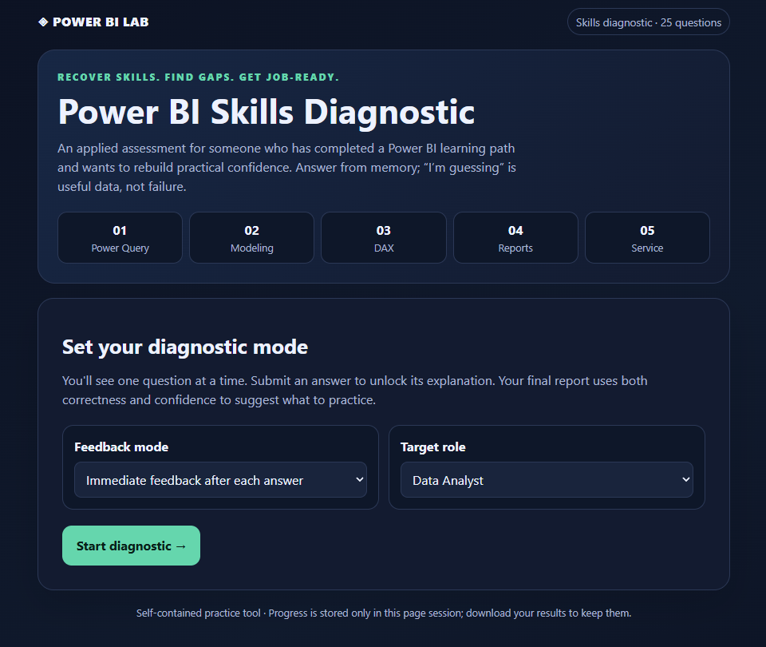
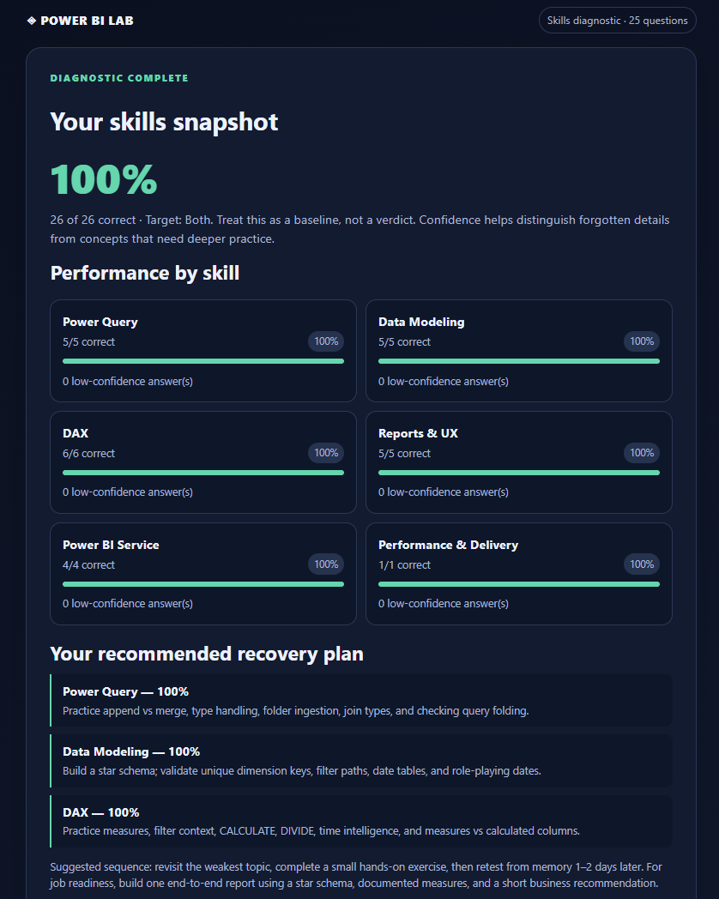

# Power BI Skills Diagnostic

An interactive assessment designed to help Data Analysts and aspiring BI Developers refresh their Power BI knowledge, identify skill gaps, and reinforce key concepts.

## Overview

Keeping technical knowledge fresh requires regular practice. I created this interactive diagnostic to revisit important Power BI concepts, test my understanding, and identify areas that need further review.

I'm sharing it as a learning resource for others who want to refresh their Power BI skills as well.

## Features

- **25 practical questions** covering core Power BI concepts.
- **Six skill areas:** Power Query, Data Modeling, DAX, Reports & UX, Power BI Service, and Performance & Delivery.
- **Answer explanations** to reinforce learning.
- **Confidence tracking** to identify topics that need review.
- **Personalized recommendations** based on performance.
- **Downloadable results** for future reference.

## Screenshots

### Diagnostic Interface

### Personal Results

## How to Use

1. Open the [Power BI Skills Diagnostic](power_bi_skills_diagnostic) in your web browser.
2. Answer the questions based on your current knowledge.
3. Review the explanations and rate your confidence.
4. Analyze your results to identify areas for improvement.
5. Use the recommendations to guide your next learning sessions.

## Technologies

- HTML
- CSS
- JavaScript

The application runs directly in a modern web browser without requiring additional software or a backend.

## Purpose

This project is part of my ongoing effort to keep my Power BI knowledge refreshed through active practice and continuous learning, while sharing useful resources with the Data Analytics community.

Feedback and suggestions are welcome!

## Disclaimer

This is a self-assessment and learning tool, not an official certification or a comprehensive measure of professional proficiency.
